<p align="center">
  
</p>

<h1 align="center">Guitar Tuner</h1>

<p align="center">
  A chromatic guitar tuner for <b>macOS</b> and <b>iPhone</b>, written in C++ with <a href="https://juce.com">JUCE</a>.<br>
  Real-time YIN pitch detection, a physically modelled reference tone, and a liquid-glass interface.
</p>

<p align="center">
  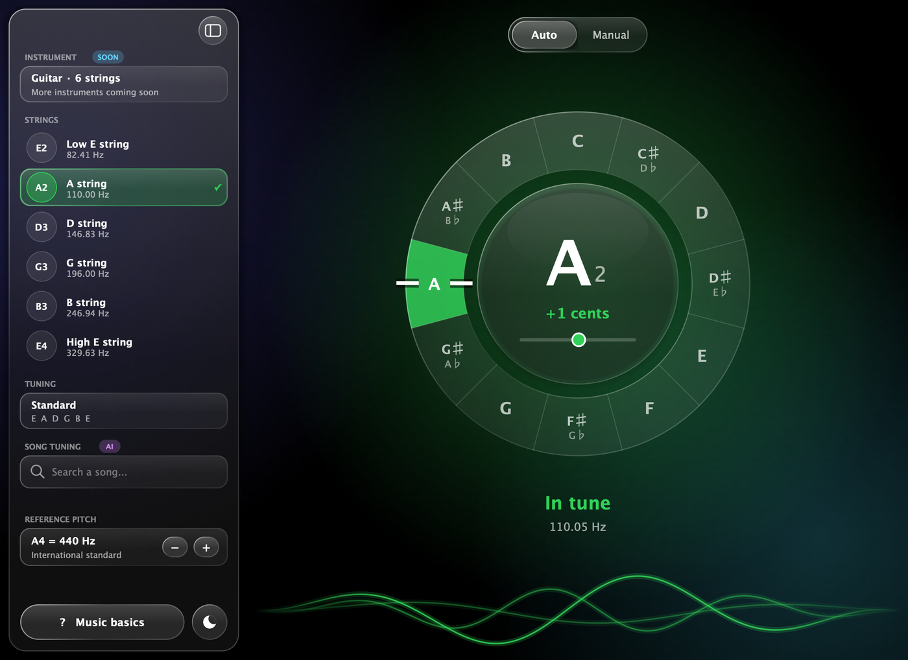
</p>

## Features

- **Automatic mode**: play any string and the 12-note ring shows the note, its octave and how many cents off it is. Green means in tune (±3 cents), orange tells you to tighten or loosen.
- **Manual mode**: pick a target note (on the ring, the string chips or the octave picker) and hear it. The reference tone is synthesised with the Karplus–Strong plucked-string model, accurate to better than 0.1 cent. With *Keep listening* on, you can tune by ear and by eye at the same time.
- **Reference pitch**: A4 from 415 to 466 Hz (baroque to modern orchestral tunings).
- **Music basics**: a 12-slide interactive tour for beginners: strings, the 12 notes, sharps and flats, frets as semitones, octaves, cents and beats, the missing fundamental. Every slide plays sounds.
- **Designed for both platforms**: a docked glass sidebar on the Mac; a slide-over drawer on the iPhone that follows your finger, springs open or closed with your flick's velocity and rubber-bands at the edge.
- **Dark and light mode**, remembered between launches; respects the system's *Reduce Motion* and *Reduce Transparency* settings.
- **A launch that feels native**: the logo is already on the iOS launch screen, the tuning fork is struck and rings, then dissolves into the tuner; a welcome card on first launch offers the tour. The microphone permission is only asked once you start tuning.

## Screenshots

| Flat: tighten the string | Manual mode, reference tone |
|:---:|:---:|
| 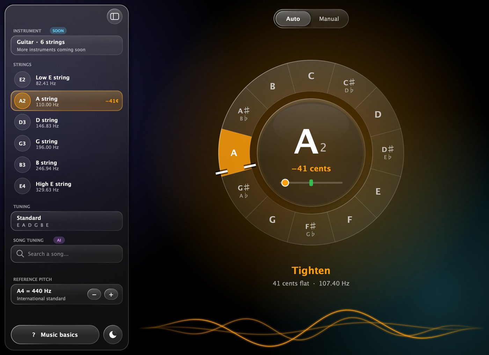 | 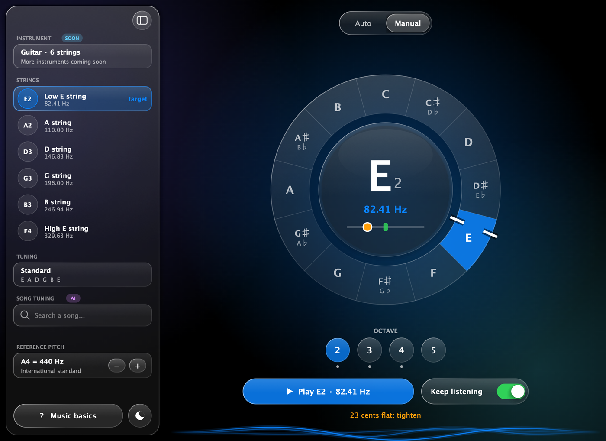 |
| **Light mode** | **Launch intro** |
| 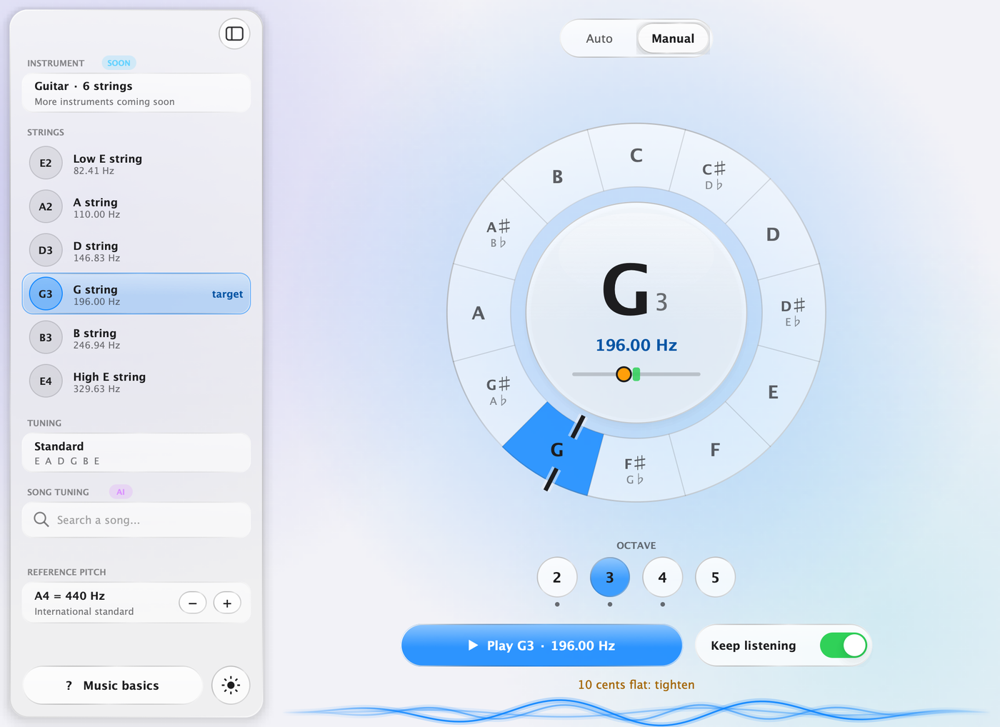 |  |

<p align="center">
  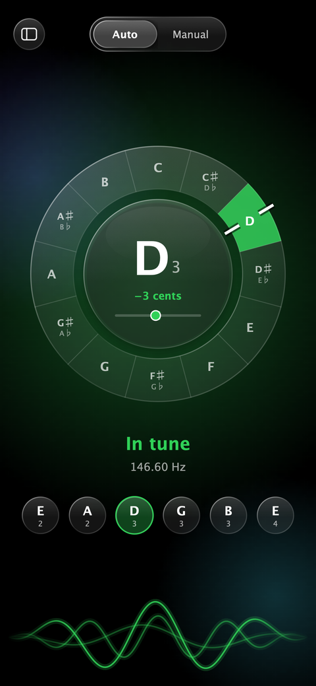
  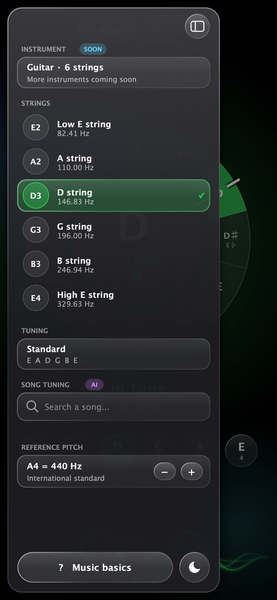
  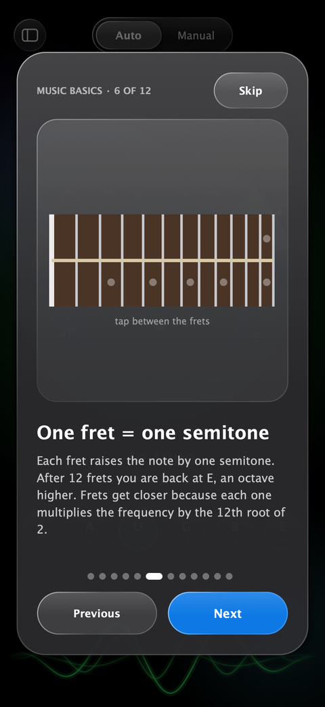
  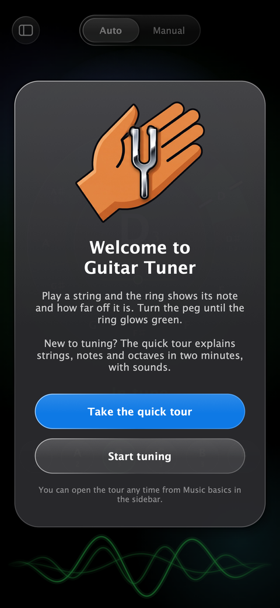
</p>

## How it works

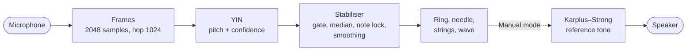

Audio runs on the real-time audio thread (no allocation, no locks); the GUI thread reads the results through `std::atomic`s 60 times per second.

### 1. Pitch detection: YIN, with an octave check

A guitar's low E is 82 Hz, but small laptop and phone microphones barely pick up its fundamental, so the strongest frequency in the spectrum is usually a harmonic. Picking the FFT peak would report the wrong note (here 572 Hz, the 7th harmonic). Time-domain methods look for the *period* instead:

<p align="center">
  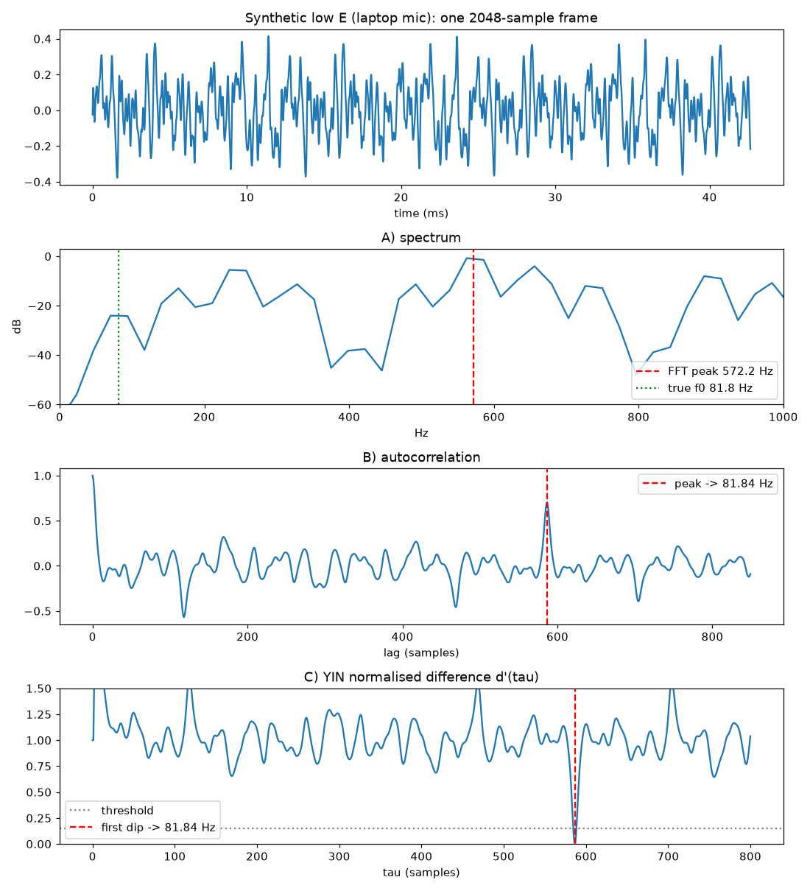
</p>

[`PitchDetector.h`](Source/PitchDetector.h) implements YIN (de Cheveigné & Kawahara, 2002): the cumulative-mean-normalised difference function d′(τ), the first dip below a threshold of 0.15, and parabolic interpolation for sub-sample precision. Range 60–1000 Hz, 2048-sample frames (~43 ms at 48 kHz).

One addition made the low E reliable: an **octave check**. When the fundamental is weak, YIN can lock onto twice the period. If the dip at 2τ is clearly deeper than the one at τ (less than 0.4×, comparing the *interpolated* dip bottoms, not raw samples), the longer period wins.

### 2. Stabiliser: from raw estimates to a calm needle

Raw YIN jumps around, especially at the pluck and as the string dies. [`PitchStabiliser.h`](Source/PitchStabiliser.h) turns it into something you can tune with:

- **Noise gate** at −62 dBFS, plus a confidence threshold of 0.85.
- **Onset detection**: a 6 dB jump starts a new note and skips the ~70 ms of noisy attack.
- **Median of 5**, then **note lock**: a new note needs 3 agreeing frames to start and 10 (~0.2 s) to replace the current one.
- **One-pole smoothing** of the cents (τ = 0.15 s), and a short **release hold** so the reading doesn't vanish the moment the string gets quiet.

<p align="center">
  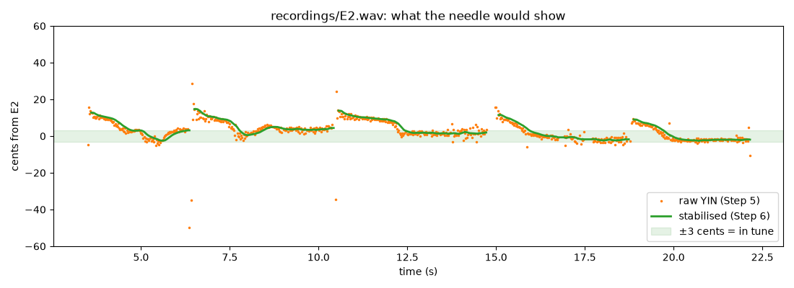
</p>

*Real recording, tuning the low E string: raw YIN in orange, what the needle shows in green.*

### 3. Reference tone: Karplus–Strong with a fractional delay

[`PluckSynth.h`](Source/PluckSynth.h) is a plucked string: a burst of noise circulating in a delay line through a gentle low-pass filter. The pitch is set by the loop length, and rounding it to whole samples would leave notes several cents out of tune, more for higher notes. A first-order **allpass filter** supplies the fractional part of the delay:

```
P = fs / f0                      total loop delay in samples
N = floor(P − 0.6)               integer delay line
d = P − 0.5 − N                  fractional part (0.5 samples go to the averaging filter)
C = (1 − d) / (1 + d)            allpass coefficient
```

Measured error: below 0.1 cent across the guitar's range. Two voices let two notes ring together (the *cents and beats* slide plays two notes a few cents apart so you can hear the beating).

### 4. Interface

All drawing is JUCE `Graphics`, with no native widgets, so one codebase looks the same on both platforms.

- **Liquid glass** ([`Theme.h`](Source/Theme.h)): a translucent body, a sheen on the upper half, a rim lit from the top-left and a soft shadow, over slowly drifting colour blobs. The same tokens drive dark and light mode.
- **Motion** ([`Spring.h`](Source/Spring.h)): the sidebar and drawer are damped springs (Apple's damping / response parameters) instead of fixed-duration animations, so they can be grabbed mid-flight and inherit the finger's velocity. Momentum projection decides whether a flick opens or closes the drawer.
- **Performance**: the background is rendered at ¼ resolution, rarely-changing components are cached as images, and the launch animation is pre-rendered at the screen's pixel size and driven by the display refresh (`VBlankAttachment`). A full tuner frame paints in ~3.6 ms (Debug build), an intro frame in ~1.6 ms.

## Prototyped in Python first

Every DSP stage was first written and tested in Python on real recordings, then ported to C++ and checked against the prototype (agreement within 0.001 cents):

- [`prototype/pitch_lab.py`](prototype/pitch_lab.py) compares FFT peak picking, autocorrelation and YIN.
- [`prototype/stabilise_lab.py`](prototype/stabilise_lab.py) is the stabiliser, plotted on the recordings in [`prototype/recordings/`](prototype/recordings).

```bash
cd prototype
python3 -m venv .venv && .venv/bin/pip install -r requirements.txt
.venv/bin/python pitch_lab.py
```

## Project layout

| Path | What's inside |
|---|---|
| `Source/PitchDetector.h` | YIN pitch detection |
| `Source/PitchStabiliser.h` | gate, onset, median, note lock, smoothing |
| `Source/PluckSynth.h` | Karplus–Strong reference tone |
| `Source/MainComponent.*` | audio callback, layout, animation loop |
| `Source/RingComponent.h` | the 12-note ring, needle and fine bar |
| `Source/SidebarComponent.h` | sidebar / drawer, string rows, reference pitch |
| `Source/GuideComponent.h` | the Music basics slideshow |
| `Source/IntroComponent.h` | launch animation and welcome card |
| `Source/Theme.h`, `Source/Spring.h` | colours, glass, accessibility settings, springs |
| `Resources/` | app icons, logo layers, iOS launch screen; `IconArt/` has the scripts that build them |
| `prototype/` | Python prototypes, test recordings, step-by-step screenshots |

## Building

Requirements: macOS with **Xcode**, and **JUCE 9** at `~/JUCE` (the module path used by the project; if yours is elsewhere, change the module paths of each exporter in Projucer).

- **Mac**: open `Builds/MacOSX/GuitarTuner.xcodeproj` and press ⌘R.
- **iPhone**: open `Builds/iOS/GuitarTuner.xcodeproj`, choose your own development team under *Signing & Capabilities*, select your phone or a simulator, and press ⌘R.

`GuitarTuner.jucer` is the source of truth for project settings: after changing it in Projucer, save to regenerate both Xcode projects.

## Roadmap

- Alternate tunings (Drop D, DADGAD, open G…) and more instruments (bass, 7-string, ukulele)
- Song tuning: search a song and get its tuning
- An Audio Unit / VST3 plugin version for use inside a DAW
- App Store release

## Author

**Ali Fuat Sakacı**, Electronic and Communications Engineering student at Politecnico di Torino.

Built with [JUCE](https://juce.com), used under the JUCE Starter licence.
